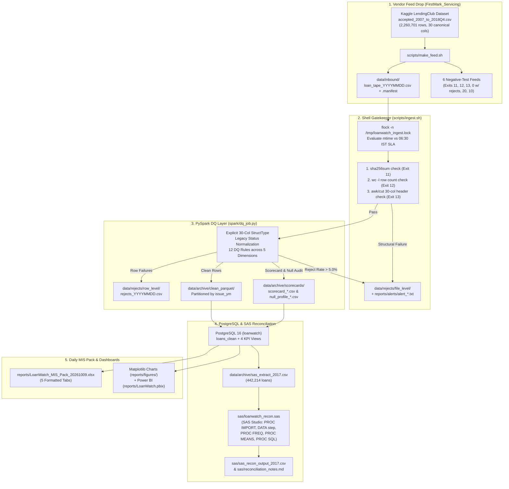
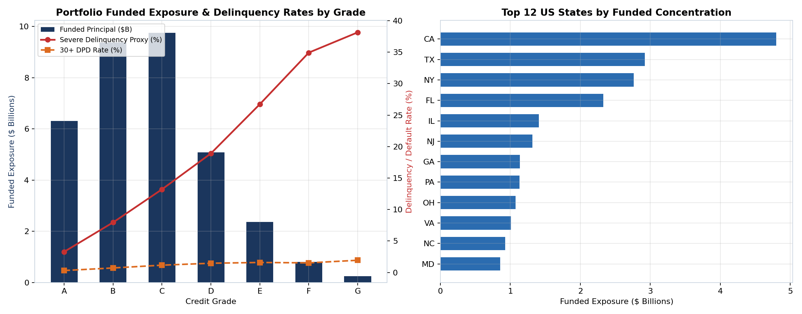
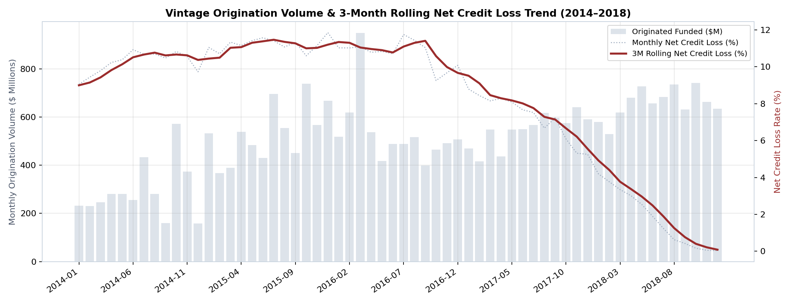
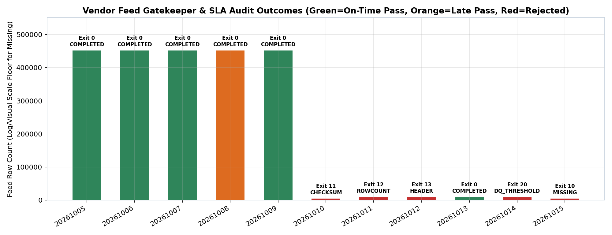

# LoanWatch — Consumer Credit Portfolio Data Quality & Daily MIS Pipeline

LoanWatch is a consumer-credit vendor feed gatekeeper, PySpark data-quality (DQ) engine, PostgreSQL analytical warehouse, SAS Studio reconciliation suite, and daily Excel MIS reporting pipeline built on the Kaggle LendingClub accepted-loans dataset (`wordsforthewise/lending-club`, `accepted_2007_to_2018Q4.csv`).

It models the daily production workflow of a **Banking / Consumer Credit Data & Information Management** team:
1. A third-party loan servicer (`FirstMark_Servicing`) drops daily loan tapes (`.csv`) and control manifests (`.manifest`) into `data/inbound/` against a `06:30 IST` (`TZ=Asia/Kolkata`) SLA cutoff.
2. A POSIX/Bash gatekeeper (`scripts/ingest.sh`) enforces single-instance locking (`flock`), logs arrival timeliness (`ON_TIME` vs `LATE`), verifies the SHA-256 digest (`sha256sum`), reconciles physical line counts (`wc -l`) against the manifest, and validates the 30-column header contract (`head`, `awk`, `cut`).
3. A PySpark engine (`spark/dq_job.py`) enforces an explicit 30-column `StructType` schema, normalizes raw formatting quirks (including mapping legacy `"Does not meet the credit policy. Status:..."` values to their base status), evaluates **12 DQ rules across 5 dimensions** (Completeness, Uniqueness, Validity, Consistency, Timeliness), routes failing records with pipe-delimited reason codes to `data/rejects/row_level/`, writes clean records to Parquet partitioned by `issue_ym`, and emits a batch DQ scorecard + 30-column null percentage profile.
4. An idempotent loader (`scripts/load_postgres.py`) upserts clean partitions into PostgreSQL (`ON CONFLICT (loan_id) DO UPDATE`) and refreshes analytical views using window functions (`LAG`, `RANK`, `DENSE_RANK`, cumulative `SUM() OVER`, and 3-month rolling `AVG() OVER`).
5. A tri-system reconciliation workflow (`sas/loanwatch_recon.sas` and `scripts/run_reconciliation.py`) cross-checks grade-level counts, funded principal, unpaid principal balance (UPB), weighted average coupon (WAC), 30+ DPD rates, and severe delinquency (proxy) rates across **PySpark**, **PostgreSQL**, and **SAS Studio** on the 2017 origination cohort (`442,214` clean loans).
6. A reporting job (`scripts/generate_mis_pack.py`) produces a formatted 5-tab daily Excel MIS workbook (`reports/LoanWatch_MIS_Pack_20261009.xlsx`) alongside charts generated with `matplotlib` (`reports/figures/`) and a Power BI dashboard built manually from the Postgres views (`reports/LoanWatch.pbix`).

---

## 1. Architecture & Pipeline Flow



---

## 2. Repository Structure

> **Note**: Project root is `~/LoanWatch` inside WSL, not `/mnt/c`.

```text
LoanWatch/
├── README.md
├── Makefile
├── requirements.txt
├── .gitignore
├── config/
│   ├── pipeline.env                    # TZ=Asia/Kolkata, 06:30 IST SLA cutoff, 5.0% max reject threshold, PG vars
│   └── expected_columns.txt            # Canonical 30-column header specification (without member_id)
├── scripts/
│   ├── prepare_source_data.py          # Extracts 30 canonical columns from Kaggle accepted_2007_to_2018Q4.csv
│   ├── make_feed.sh                    # Splits real dataset into 5 daily feeds + 6 negative-test feeds + manifests
│   ├── ingest.sh                       # Gatekeeper: flock, SLA check, sha256sum, wc -l, awk header check, Spark trigger
│   ├── load_postgres.py                # Idempotent PostgreSQL loader (ON CONFLICT (loan_id) DO UPDATE)
│   ├── run_reconciliation.py           # Exports 2017 cohort and compares PySpark, PostgreSQL, and SAS outputs
│   ├── generate_mis_pack.py            # Generates 5-tab Excel MIS workbook (pandas + xlsxwriter)
│   ├── render_dashboard_previews.py    # Generates portfolio & SLA visual charts with matplotlib
│   └── cron_loanwatch                  # Crontab entry (06:35 IST Monday-Friday)
├── spark/
│   ├── __init__.py
│   ├── schema.py                       # Explicit 30-column PySpark StructType definitions
│   ├── dq_rules.py                     # 12 DQ rule functions across 5 dimensions + first-row deduplication
│   └── dq_job.py                       # Spark driver writing partitioned Parquet, row-level rejects, and scorecards
├── sql/
│   ├── 01_schema_and_tables.sql        # DDL for loans_clean, dq_scorecard_history, dq_column_null_profile, vendor_feed_sla_log
│   ├── 02_vw_delinquency_vintage.sql   # 30+ DPD, severe delinquency (proxy), WAC by Grade & Vintage with LAG() MoM bps
│   ├── 03_vw_exposure_concentration.sql# Exposure by Purpose & State with DENSE_RANK() and cumulative portfolio share
│   ├── 04_vw_chargeoff_loss_trend.sql  # Gross charge-offs, recoveries, Net Credit Loss (NCL), 3M rolling average
│   └── 05_reconciliation_extract.sql   # 2017 vintage cohort control totals view by credit grade
├── sas/
│   ├── loanwatch_recon.sas             # SAS Studio program (PROC IMPORT guessingrows=max, DATA step, PROC FREQ/MEANS/SQL)
│   ├── sas_recon_output_2017.csv       # Output control table produced by running the program in SAS Studio (manual)
│   └── reconciliation_notes.md         # Tri-system reconciliation report (PySpark vs PostgreSQL vs SAS)
├── reports/
│   ├── LoanWatch_MIS_Pack_20261009.xlsx
│   ├── LoanWatch.pbix                  # Built manually in Power BI Desktop from the Postgres views
│   ├── alerts/                         # Incident alert summaries for failed/missing feeds
│   └── figures/                        # Matplotlib portfolio, vintage loss, and vendor SLA charts
├── tests/
│   ├── conftest.py                     # Shared local[2] SparkSession fixture
│   ├── test_dq_rules.py                # Pytest unit suite covering all 12 DQ rules and normalization edge cases
│   └── test_corrupted_feeds.sh         # Integration test verifying exit codes 11, 12, 13, 0 w/ rejects, 20, and 10
├── docs/
│   ├── RUNBOOK.md                      # Operational L1/L2 support runbook
│   ├── DQ_RULES_REGISTER.md            # Governance catalog of the 12 DQ rules
│   └── DATA_DICTIONARY.md              # 30-column LendingClub-to-MIS attribute dictionary
└── data/
    ├── raw/
    ├── inbound/
    ├── processing/
    ├── archive/
    └── rejects/
```

---

## 3. Production Dataset & Vendor SLA Execution Summary

The pipeline processes the real Kaggle LendingClub file (`accepted_2007_to_2018Q4.csv`, `1,675,133,810` bytes, **2,260,701** raw data rows across 30 canonical columns). Across the 5 daily production feeds (`20261005`–`20261009`), **2,256,390** clean loans pass all 12 DQ rules and are loaded into PostgreSQL, while **4,311** rows (`0.19%`) are isolated to `data/rejects/row_level/` (predominantly real LendingClub rows with `dti` outside `[0, 100]`, missing underwriting attributes, and the two trailing policy-code summary footer lines).

### Daily Feeds & 6 Negative-Test Scenarios (`data/archive/vendor_sla_history.csv`)

| Batch Date | Scenario / Feed Type | Arrival (IST) | SLA Status (`06:30`) | Manifest Rows | Actual Rows | Clean Rows | Rejected Rows | Reject % | Pipeline Status | Exit Code |
| :---: | :--- | :---: | :---: | ---: | ---: | ---: | ---: | ---: | :--- | :---: |
| `20261005` | Clean Daily Feed 1 | `06:12` | `ON_TIME` | 452,141 | 452,141 | 451,929 | 212 | `0.05%` | `COMPLETED` | `0` |
| `20261006` | Clean Daily Feed 2 | `06:08` | `ON_TIME` | 452,141 | 452,141 | 450,409 | 1,732 | `0.38%` | `COMPLETED` | `0` |
| `20261007` | Clean Daily Feed 3 | `06:21` | `ON_TIME` | 452,141 | 452,141 | 451,924 | 217 | `0.05%` | `COMPLETED` | `0` |
| `20261008` | Clean Daily Feed 4 (Simulated Late via `touch -d`) | `07:18` | `LATE` | 452,141 | 452,141 | 450,662 | 1,479 | `0.33%` | `COMPLETED` | `0` |
| `20261009` | Clean Daily Feed 5 (Includes 2 Policy Footer Lines) | `06:15` | `ON_TIME` | 452,137 | 452,137 | 451,466 | 671 | `0.15%` | `COMPLETED` | `0` |
| **Subtotal** | **5 Production Feeds (Full Kaggle Dataset)** | — | **4 On-Time, 1 Late** | **2,260,701** | **2,260,701** | **2,256,390** | **4,311** | **`0.19%`** | — | — |
| `20261010` | Negative Test 1: Truncated File (Checksum Fires First) | `06:10` | `ON_TIME` | 10,000 | 1,250 | 0 | 1,250 | `100.00%` | `REJECTED_CHECKSUM` | `11` |
| `20261011` | Negative Test 2: Wrong `EXPECTED_ROWS` w/ Valid SHA-256 | `06:12` | `ON_TIME` | 10,500 | 10,000 | 0 | 10,000 | `100.00%` | `REJECTED_ROWCOUNT` | `12` |
| `20261012` | Negative Test 3: Renamed Column (`loan_amnt` -> `principal_amt`) | `06:14` | `ON_TIME` | 10,000 | 10,000 | 0 | 10,000 | `100.00%` | `REJECTED_HEADER` | `13` |
| `20261013` | Negative Test 4: Small Payload Breach (~1% Bad Rows) | `06:16` | `ON_TIME` | 10,000 | 10,000 | 9,899 | 101 | `1.01%` | `COMPLETED` (w/ rejects) | `0` |
| `20261014` | Negative Test 5: >8% Payload Breach (9.51% > 5.0% Limit) | `06:18` | `ON_TIME` | 10,000 | 10,000 | 9,049 | 951 | `9.51%` | `REJECTED_DQ_THRESHOLD` | `20` |
| `20261015` | Negative Test 6: Missing Feed in `data/inbound/` | `N/A` | `MISSING` | 0 | 0 | 0 | 0 | `0.00%` | `REJECTED_MISSING` | `10` |

---

## 4. Portfolio KPIs & Visual Analytics

Charts are generated directly from the PostgreSQL analytical views via `scripts/render_dashboard_previews.py` (`matplotlib`), complementing the Power BI workbook (`reports/LoanWatch.pbix`).

### Portfolio Exposure & Delinquency by Credit Grade and Top US States


### Vintage Origination Volume & 3-Month Rolling Net Credit Loss Trend


### Vendor Feed Gatekeeper & SLA Audit Outcomes


---

## 5. Tri-System Reconciliation (2017 Cohort: PySpark vs. PostgreSQL vs. SAS)

On the 2017 origination cohort (`442,214` clean loans exported to `data/archive/sas_extract_2017.csv`), control totals are reconciled across PySpark, PostgreSQL (`vw_reconciliation_2017_by_grade`), and SAS (`sas/loanwatch_recon.sas` -> `sas/sas_recon_output_2017.csv`). Full details are in [`sas/reconciliation_notes.md`](sas/reconciliation_notes.md).

| Grade | Loans (Spark / PG / SAS) | Count Diff | Funded Principal ($) | Current UPB ($) | WAC (%) | 30+ DPD Rate (%) | Severe Delinq Proxy (%) |
| :---: | ---: | ---: | ---: | ---: | ---: | ---: | ---: |
| **A** | 78,644 | 0 | 1,093,992,750.00 | 366,046,283.18 | 6.951981 | 0.628147 | 2.349830 |
| **B** | 132,794 | 0 | 1,833,312,900.00 | 690,622,461.45 | 10.555523 | 1.393135 | 5.554468 |
| **C** | 144,653 | 0 | 2,215,236,425.00 | 900,323,536.22 | 14.287240 | 2.127851 | 9.932044 |
| **D** | 56,408 | 0 | 887,308,150.00 | 334,251,822.96 | 18.753852 | 2.783293 | 15.019146 |
| **E** | 20,077 | 0 | 338,843,550.00 | 115,784,719.29 | 24.751472 | 3.207651 | 20.859690 |
| **F** | 6,211 | 0 | 117,996,825.00 | 37,106,023.06 | 29.777581 | 3.654806 | 27.757205 |
| **G** | 3,427 | 0 | 71,634,500.00 | 21,303,284.39 | 30.870463 | 3.910125 | 31.310184 |

---

## 6. Quickstart & Execution (WSL Ubuntu)

```bash
# 1. Clone into ~/LoanWatch inside WSL and configure environment
cd ~/LoanWatch
make setup

# 2. Split Kaggle dataset into 5 daily feeds + 6 negative-test scenarios
make feeds

# 3. Ingest the 5 production feeds through Shell -> PySpark -> PostgreSQL
make ingest-clean

# 4. Run the 6 negative-test scenarios and verify exit codes (11, 12, 13, 0 w/ rejects, 20, 10)
make test-negative

# 5. Run 2017 cohort tri-system reconciliation, generate Excel MIS Pack & matplotlib charts
make recon
make report

# 6. Run pytest unit test suite for all 12 PySpark DQ rules
make test
```
